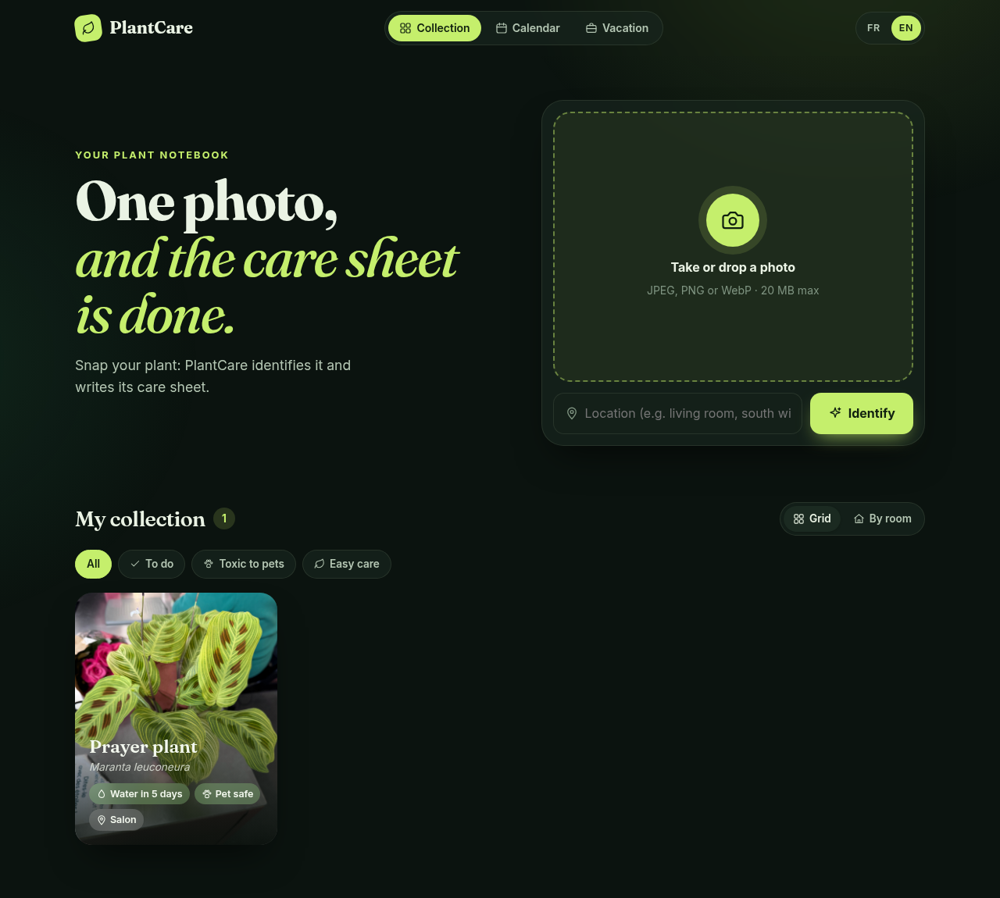
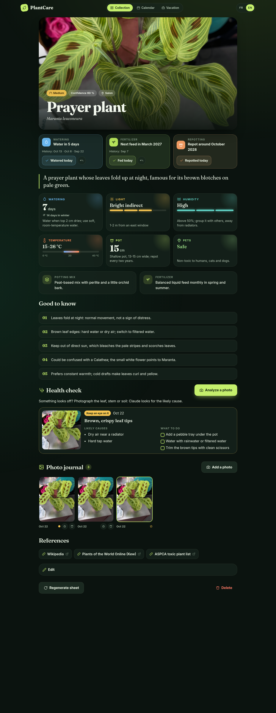
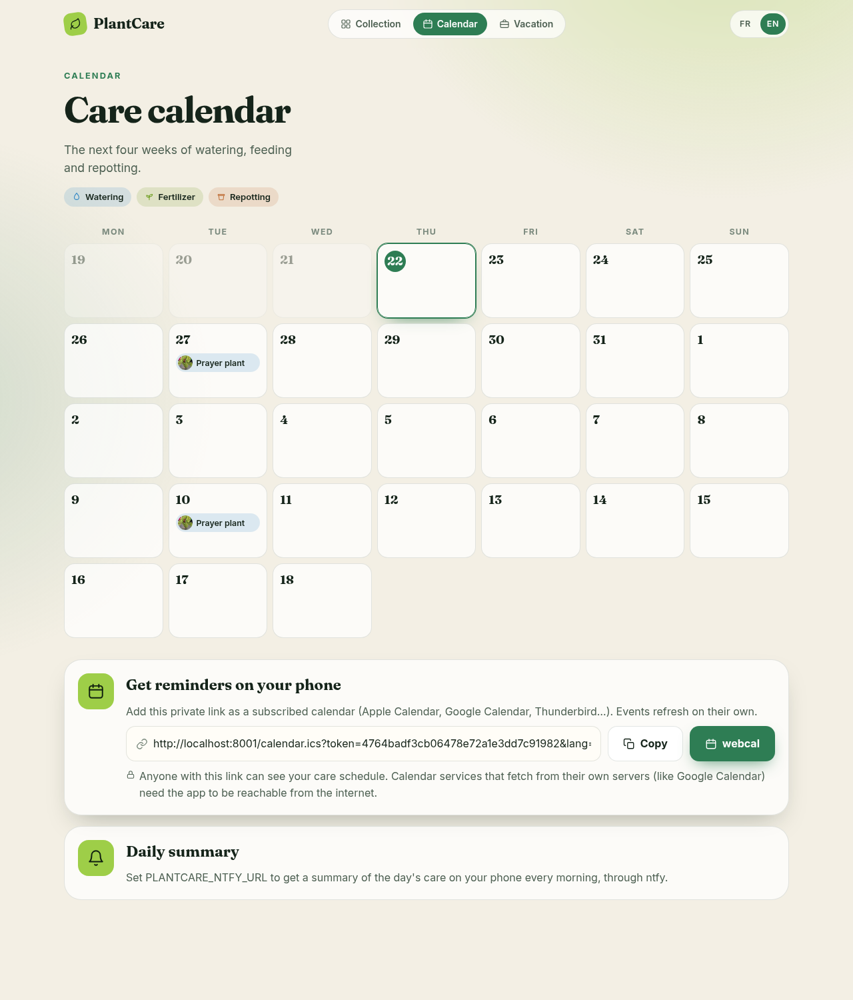
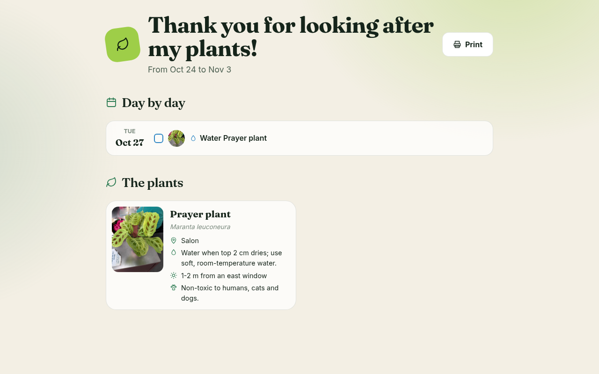
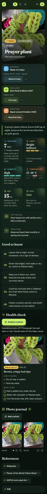
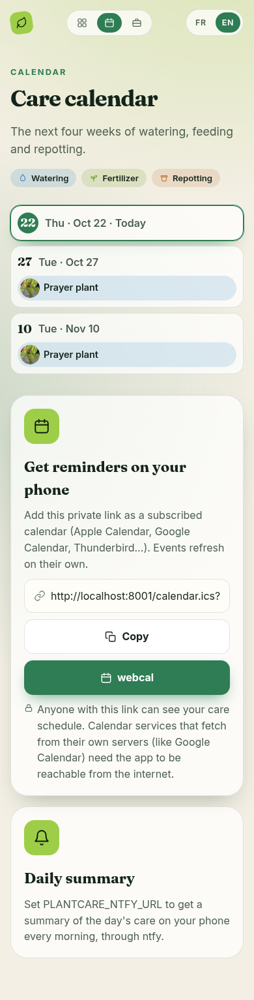
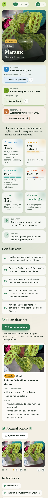

# PlantCare

A self-hosted plant notebook. Snap a photo of a plant: Claude identifies it and writes a concise care sheet. PlantCare then plans watering, feeding and repotting, reminds you when something is due, and helps you figure out what is wrong when a plant looks unwell.



## Features

- **Photo identification.** Upload or take a photo; Claude returns the species, a confidence score and a structured care sheet.
- **Care sheets at a glance.** Watering intervals for the growing season and for winter, light and humidity gauges, temperature range, pot size, pet safety, potting mix, fertilizer and a few tips.
- **Care tracking.** Log waterings, feedings and repottings in one tap. Watering follows the season, feeding pauses in winter, and repotting comes back every year or two. Everything due shows up at the top of the home page, with a **Water all** button.
- **Health checks.** Photograph a leaf or stem that looks off: Claude suggests the likely causes and what to do.
- **Photo journal.** Add photos over time to follow a plant's growth, and pick the one shown on its card.
- **Calendar.** A four-week view of upcoming care, plus a private, read-only iCal feed to get reminders in Apple Calendar, Google Calendar, Thunderbird and others.
- **Daily summary.** An optional morning notification through [ntfy](https://ntfy.sh) listing the day's care.
- **Vacation mode.** Create a shareable, printable page for whoever looks after your plants: a day-by-day checklist and how to recognize each plant. The link only works for the chosen dates.
- **Collection views.** Filter by plants that need care, toxic to pets or easy care, and group them by room.
- **Corrections.** Wrong species? Enter the right name and the sheet is regenerated from it. You can also edit the location or regenerate a sheet from its photo.
- **References.** Each sheet links to Wikipedia, Plants of the World Online (Kew) and the ASPCA toxic plant list, built from the scientific name.
- **Installable.** PlantCare is a progressive web app: add it to your phone's home screen.
- **English and French.** The interface follows your browser language and has a FR/EN switch. Texts are generated in both languages at once, so switching is instant.
- **Light and dark themes**, following your system setting, and a layout that works on phones.
- **Optional password** to protect the app.

| Care sheet | Calendar |
| --- | --- |
|  |  |

| Vacation page | Mobile | Mobile calendar | French |
| --- | --- | --- | --- |
|  |  |  |  |

## How Claude is called

- If the `claude` CLI ([Claude Code](https://claude.com/claude-code)) is on the `PATH`, PlantCare uses it. No API key is needed; calls count against your Claude Code usage. The CLI runs with tools, MCP servers and project settings disabled to keep each call small.
- Otherwise PlantCare calls the Anthropic API directly, and `ANTHROPIC_API_KEY` must be set.
- The default model is `claude-haiku-5-5`. Set `PLANTCARE_MODEL` to use another one (for example `claude-sonnet-5-5` or `claude-opus-5-5` for harder identifications, at a higher cost per photo).

Claude is only called when you identify a plant, regenerate a sheet or run a health check. Each call takes about 20 to 30 seconds.

## Running locally

Requires [uv](https://docs.astral.sh/uv/).

```bash
uv sync
uv run uvicorn plantcare.main:app --reload
```

Then open <http://localhost:8000>.

## Running with Docker

```bash
cp .env.example .env   # then fill in ANTHROPIC_API_KEY
docker compose up -d --build
```

The image is based on `python:3.13-slim` and builds on both x86 (NUC, server) and ARM (Raspberry Pi). The container does not include the Claude CLI, so it uses the API and needs the key.

## Configuration

All settings are environment variables (see `.env.example`).

| Variable | Default | Purpose |
| --- | --- | --- |
| `ANTHROPIC_API_KEY` | | API key, required when the Claude CLI is not available |
| `PLANTCARE_MODEL` | `claude-haiku-5-5` | Model used for identification, care sheets and health checks |
| `PLANTCARE_PASSWORD` | empty | Enables a login page when set |
| `PLANTCARE_SECRET` | generated | Signs login sessions, the calendar link and vacation pages; stored in `data/secret.key` when not set |
| `PLANTCARE_DATA` | `data` | Folder for the database and photos |
| `TZ` | system | Timezone used to decide what "today" is |
| `PLANTCARE_HEMISPHERE` | `north` | `north` (growing season March to September) or `south` |
| `PLANTCARE_NTFY_URL` | empty | ntfy topic URL, e.g. `https://ntfy.sh/my-plants-a1b2c3`; enables the daily summary |
| `PLANTCARE_NTFY_TOKEN` | empty | Access token, for protected ntfy topics |
| `PLANTCARE_NOTIFY_TIME` | `08:30` | Time of the daily summary |
| `PLANTCARE_NOTIFY_LANG` | `en` | Language of the daily summary (`en` or `fr`) |
| `PLANTCARE_PUBLIC_URL` | empty | URL opened when you tap the notification |

## Reminders

- **Calendar feed.** The Calendar page shows a private iCal link. Add it as a *subscribed* calendar: each upcoming watering, feeding or repotting becomes an all-day event with a 9:00 reminder. The link is read-only, and anyone who has it can read your care schedule. Apple Calendar on a phone fetches the feed from the device itself, so a VPN such as Tailscale is enough; Google Calendar fetches it from Google's servers, so the app must be reachable from the internet.
- **Daily summary.** With `PLANTCARE_NTFY_URL` set, PlantCare sends one notification a day listing the care due, and nothing on days with nothing to do. Install the ntfy app and subscribe to the same topic. Use a hard-to-guess topic name on ntfy.sh, since public topics can be read by anyone who knows them. The Calendar page has a button to send a test notification.
- Watering appears in reminders once you have logged a first watering for a plant. Feeding and repotting are planned from the day the plant was added.

## Vacation mode

The Vacation page creates a link for a date range. The page behind it lists, day by day, which plants to water or feed, and shows each plant with its photo, location, watering and light instructions, and whether it is toxic to pets. It is read-only, prints cleanly, and only works for the chosen dates.

## Data

- `data/plantcare.db`: SQLite database (plants, care sheets as JSON, care log, photo journal and health checks).
- `data/photos/`: photos.
- `data/secret.key`: generated signing key.

To back up, copy the `data/` folder. Older databases are migrated automatically at startup.

## Security

Without `PLANTCARE_PASSWORD`, anyone who can reach the app can use it, and every identification or health check triggers a paid Claude call. Before exposing PlantCare to the internet, set a password and serve it over HTTPS (behind a reverse proxy such as Caddy or Traefik), or keep it behind a VPN.
